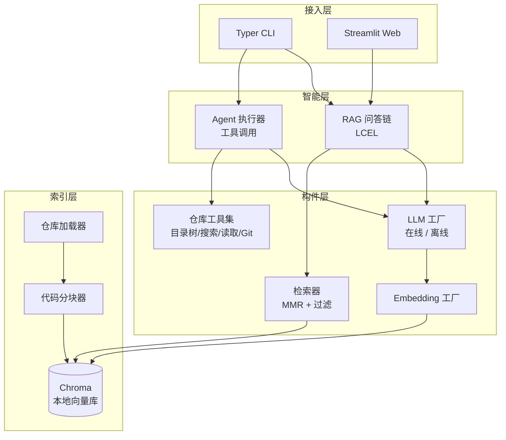
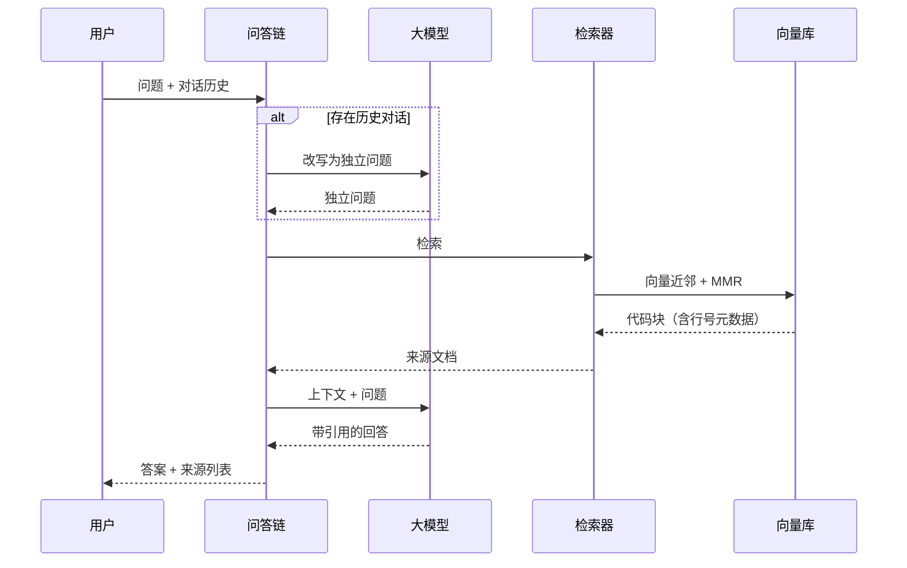

# RepoMind

[](https://github.com/UrimAndThummim/repomind/actions/workflows/ci.yml)
[](https://www.python.org/)
[](https://python.langchain.com/)
[](LICENSE)

**RepoMind 是一个面向本地代码仓库的智能问答助手。** 给它一个本地仓库路径，它会把源码解析、切分并建立向量索引，之后你可以用自然语言提问：项目入口在哪、某个功能由谁实现、模块之间怎么调用。回答会附带具体的文件路径和行号，全部检索过程都在本地完成，代码不会上传。

在线大模型（OpenAI 兼容接口，已验证 DeepSeek）和本地离线模型（Ollama，如 Qwen2.5）可以通过配置一键切换，断网环境下也能完整运行。

---

## 为什么做这个项目

读开源项目是这学期最花时间的事。一个中等规模的仓库里有上百个文件，想搞清楚"这个接口最终走到了哪段逻辑"，通常要在 `grep`、目录树和编辑器之间来回跳，新接触一个代码库的前几个小时基本都在找路。

通用的大模型对话产品能回答编程问题，但它们看不到我本地的代码，把整个仓库贴进对话框既不现实也有泄露风险。已有的一些 RAG  demo 大多直接对文本做定长切分，代码的类和函数经常被从中间切断，检索出来的片段没法看。

RepoMind 针对代码场景做了几件事：

- 按语言的语法边界切分，尽量保持类、函数的完整，并记录每个块的起止行号和符号名；
- 回答必须基于检索到的片段，给出 `文件:行号` 引用，检索不到就明说，不允许编造；
- 除了 RAG 问答，还提供一个会自己调用工具的 Agent，可以自主浏览目录、正则搜代码、查 Git 历史；
- 模型层做了抽象，在线 API 和本地 Ollama 对上层是同一个接口。

## 功能一览

| 功能 | 说明 |
| --- | --- |
| 仓库索引 | 递归遍历仓库，自动跳过 `.git`、`node_modules`、虚拟环境等目录，支持 15+ 种源码与配置文件格式 |
| 代码感知分块 | 基于 LangChain 语言分隔符按类/函数边界切分，块上携带路径、语言、行号、符号名等元数据 |
| 语义检索 | Chroma 本地向量库 + MMR 最大边际相关检索，兼顾相关性与多样性，支持按仓库过滤 |
| RAG 问答 | 全 LCEL 拼装的问答链，支持多轮历史改写，回答带来源引用 |
| Agent 工具 | 目录树、正则代码搜索、文件读取、Git 提交历史四个只读工具，模型自主编排调用 |
| 双模型后端 | 在线 OpenAI 兼容接口 / 离线 Ollama，配置项切换，无需改代码 |
| 两种使用方式 | Typer 命令行 + Streamlit Web 界面 |

## 系统架构

系统按"构件"思路划分，每个目录是一个高内聚、低耦合的构件，构件之间只依赖 LangChain 的标准抽象（`BaseChatModel`、`Embeddings`、`BaseRetriever`、`BaseTool`），不依赖具体实现。



一次问答的完整链路：



## 快速开始

### 环境要求

- Python 3.10+（开发与测试使用 3.12）
- 离线模式需要安装 [Ollama](https://ollama.com/) 并拉取模型
- 在线模式需要一个 OpenAI 兼容接口的 API Key

### 安装

```bash
git clone https://github.com/UrimAndThummim/repomind.git
cd repomind

python -m venv .venv
source .venv/bin/activate        # Windows: .venv\Scripts\activate
pip install -e .
```

### 配置模型

复制环境变量模板：

```bash
cp .env.example .env
```

**在线模式（默认）。** 编辑 `.env`，填入 API Key。默认使用 DeepSeek，换成其他兼容接口只需要改模型名和地址：

```ini
REPOMIND_LLM_PROVIDER=online
REPOMIND_ONLINE_MODEL=deepseek-chat
REPOMIND_ONLINE_API_KEY=sk-你的密钥
REPOMIND_ONLINE_BASE_URL=https://api.deepseek.com/v1
```

**离线模式。** 先在 Ollama 中拉取聊天与嵌入模型：

```bash
ollama pull qwen2.5:7b
ollama pull nomic-embed-text
```

然后把 `.env` 中的 provider 改为 offline：

```ini
REPOMIND_LLM_PROVIDER=offline
REPOMIND_EMBEDDING_PROVIDER=offline
REPOMIND_OFFLINE_MODEL=qwen2.5:7b
REPOMIND_OFFLINE_EMBEDDING_MODEL=nomic-embed-text
```

### 命令行使用

第一步，给仓库建索引：

```bash
repomind index /path/to/your/repo
```

单次提问：

```bash
repomind ask /path/to/your/repo "数据库连接是在哪里初始化的？"
```

多轮对话（`/clear` 清空历史，`/exit` 退出）：

```bash
repomind chat /path/to/your/repo
```

Agent 模式，模型会自行决定调用哪个工具：

```bash
repomind agent /path/to/your/repo
```

### Web 界面

```bash
streamlit run repomind/app.py
```

在侧边栏填入仓库路径，点击「构建索引」再「加载仓库」，即可在对话界面提问，每条回答下方可以展开查看引用来源。

## 项目结构

```
repomind/
├── repomind/
│   ├── config.py               # 全局配置（pydantic-settings，环境变量驱动）
│   ├── cli.py                  # Typer 命令行入口
│   ├── app.py                  # Streamlit Web 入口
│   ├── core/                   # 核心构件
│   │   ├── llm_factory.py      # 聊天模型工厂（在线/离线）
│   │   ├── embeddings.py       # 嵌入模型工厂
│   │   └── prompts.py          # 提示词模板
│   ├── indexing/               # 索引构件
│   │   ├── loader.py           # 仓库遍历与文件加载
│   │   ├── chunker.py          # 代码感知分块与行号定位
│   │   └── vectorstore.py      # Chroma 管理与索引构建
│   ├── retrieval/              # 检索构件
│   │   ├── retriever.py        # MMR 检索器与元数据过滤
│   │   └── chain.py            # LCEL 问答链与会话管理
│   ├── agent/                  # 智能体构件
│   │   ├── tools.py            # 四个只读仓库工具
│   │   └── assistant.py        # Agent 装配
│   └── utils/logging.py
├── tests/                      # 18 个单元测试（假模型，无需 API Key）
├── docs/
│   ├── architecture.md         # 架构设计与取舍
│   └── usage.md                # 详细使用说明
├── examples/demo_script.md     # 演示用例脚本
├── Dockerfile
├── docker-compose.yml
├── Makefile
└── .github/workflows/ci.yml
```

## 关键设计说明

### 1. 工厂模式屏蔽模型差异

`llm_factory` 和 `embeddings` 用同一个 provider 枚举决定实例化 `ChatOpenAI` 还是 `ChatOllama`，返回类型统一是 LangChain 的 `BaseChatModel` / `Embeddings`。这意味着问答链、Agent 完全不知道背后是哪个模型，切换后端只改 `.env`，符合开闭原则。

### 2. 代码感知分块与行号定位

通用文本切分器会把一个函数切成两半。`chunker` 通过 `RecursiveCharacterTextSplitter.from_language` 拿到每种语言的语法分隔符（Python 的 `class`/`def`、Java 的花括号等），优先沿语法边界切。切完后用字符偏移在原文中定位每个块，计算起止行号，并正则提取块内第一个符号名。这些元数据最终会出现在回答引用里。

### 3. MMR 检索与来源可信

普通 top-k 检索容易返回内容高度重复的片段。检索器使用 MMR（最大边际相关）策略，在相关性和多样性之间做权衡。提示词强制要求模型只依据给定片段回答、引用 `路径:行号`，并明确写出"依据不足时直接说明"，从机制上抑制幻觉。

### 4. Agent 与工具的安全边界

四个工具全部是只读操作。`read_file` 会对传入路径做 resolve 并校验它仍在仓库根目录之内，拦截 `../../` 路径穿越；`code_search` 对非法正则做了捕获；`git_log` 通过 subprocess 调用并设置超时，非 Git 仓库会返回友好提示而不是报错。

### 5. 全 LCEL 的链装配

问答链从历史改写、问题路由、检索、上下文格式化到生成，全部由 `RunnablePassthrough`、`RunnableBranch`、`RunnableLambda` 等 LCEL 原语拼装，每一步都可以单独替换和测试，也天然支持流式与异步调用。

## 运行测试

测试不依赖任何真实大模型，使用确定性哈希嵌入和 LangChain 假聊天模型：

```bash
pytest
```

```
18 passed in 2.51s
```

## 技术栈

| 用途 | 选型 |
| --- | --- |
| 编排框架 | LangChain 1.x / LangChain Classic |
| 向量数据库 | Chroma（本地持久化） |
| 在线模型 | OpenAI 兼容接口（DeepSeek 验证） |
| 离线模型 | Ollama（Qwen2.5 验证） |
| 命令行 | Typer + Rich |
| Web 界面 | Streamlit |
| 配置 | pydantic-settings + python-dotenv |
| 测试 | pytest |
| 容器 | Docker / Docker Compose |

## Docker 部署

离线模式下与 Ollama 一起启动：

```bash
docker compose up -d
```

随后访问 `http://localhost:8501`。注意宿主机的 Ollama 需要允许容器访问，详见 `docs/usage.md`。

## 后续计划

- [ ] 增量索引：基于 Git diff 只更新变更文件，而不是全量重建
- [ ] 调用关系图：结合静态分析生成函数级调用图，作为结构化检索通道
- [ ] 混合检索：BM25 关键词检索与向量检索结果融合
- [ ] 多仓库联合问答

## 许可证

基于 [MIT License](LICENSE) 开源，可自由用于学习与二次开发。
